<!-- Tout ce qui est hors du bloc STATS est libre : il n'est jamais réécrit par le script. -->

<!-- STATS:START -->

<picture>
  <source media="(prefers-color-scheme: dark)" srcset="assets/overview-dark.svg">
  
</picture>

<picture>
  <source media="(prefers-color-scheme: dark)" srcset="assets/activity-dark.svg">
  
</picture>

<picture>
  <source media="(prefers-color-scheme: dark)" srcset="assets/languages-dark.svg">
  
</picture>

<picture>
  <source media="(prefers-color-scheme: dark)" srcset="assets/habits-dark.svg">
  
</picture>

<picture>
  <source media="(prefers-color-scheme: dark)" srcset="assets/facts-dark.svg">
  
</picture>

<picture>
  <source media="(prefers-color-scheme: dark)" srcset="assets/projects-dark.svg">
  
</picture>

Dépôts publics : <a href="https://github.com/GitOfSplayce/gd-map">gd-map</a> · <a href="https://github.com/GitOfSplayce/LUMMEA_SONGS">LUMMEA_SONGS</a>

### Stack

Détectée automatiquement dans les manifestes (package.json, pyproject, Cargo.toml…) · le chiffre = nombre de projets

**Interfaces** 
           

**Desktop & natif** 
  

**Back-end & données** 
            

**IA** 
   

**Outillage, tests & déploiement** 
         

### L’équipe

---

Généré le 25 novembre 2026 à 15:40 à partir des 47 dépôts du compte ·
<a href="scripts/generate.mjs">le script</a> · <a href=".github/workflows/update-readme.yml">le workflow</a>

<!-- STATS:END -->
